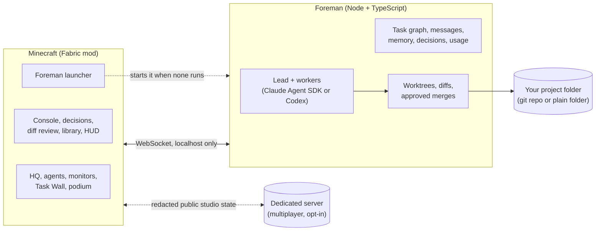

<div align="center">

# AgentCraft

**A team of Claude agents doing real work on your code, inside a Minecraft studio you can walk around in.**

*Powered by Claude*

[](LICENSE)
[](https://www.minecraft.net)
[](https://fabricmc.net)
[](https://code.claude.com/docs/en/agent-sdk/overview)
[](#development)


</div>

<br>

A fork of [blendi-remade/agentcraft](https://github.com/blendi-remade/agentcraft).

Multi-agent coding usually means a wall of terminal text. AgentCraft turns it into a place.

You type a goal. A lead agent reads your project folder (a git repo, or any folder, even an empty
one), writes a plan and pins tasks to a wall. Workers walk to their desks, sit down and start coding
in their own git worktrees while their monitors stream every file they read and every line they
change. When a call is genuinely yours, an agent walks over to you with a question. When work is
ready, you review the real diff and press **Merge**. Nothing touches your project without that
click, and nothing is ever pushed.

Close the game and the agents keep working. Open it again and the studio catches up.

<br>

## What this version adds

Everything upstream does still works the same way. On top of it:

| Addition | What you get | From |
|---|---|---|
| **Survival world** | A second save, **AgentCraft Survival**: a real generated world with vanilla rules. The HQ is built on the flattest ground near spawn and blended into the terrain, with doors and back doors, a workbench corner, your own bedroom, a crop farm and animal pens, no trees near the farms, and hidden lighting so nothing hostile spawns near the base. Launch with `-World survival` (`--world survival` on macOS and Linux). | |
| **HQ grounds** | In both worlds: a garden wall with a gate in the lychgate, a glazed conservatory on the west terrace, and the ring path joined to the terrace steps. | |
| **Guided start for Windows** | Double-click `start-agentcraft.cmd`. It checks git, Node.js 22, Java 25 and your Claude login, offers to install what is missing, then asks for the backend, the repo and the world. | |
| **The mod starts the Foreman** | No terminal needed. When the game starts and no Foreman answers, the mod starts one in the background (and reuses one that is already running). `/foreman` in the console shows its state, log and controls. | [larattalabs](#credits) |
| **Login mode hardening** | With your Claude login, an API key, base URL or provider switch left in the shell never reaches the agents. The banner shows the auth mode (`auth ok (claude login)`). Both launchers have a `login` command and check the login before starting. | [NoahBall25](#credits) |
| **Usage in game** | API spend, or with a claude.ai login your plan windows (5h, 7d, per model) with reset times, in the console header, `/status`, the HUD pill and the feed monitor. | |
| **Usage-limit holds** | A turn that hits the plan limit waits for the reset and resumes instead of failing its task. Near a limit, fewer workers run at once. Holds survive a restart. | [larattalabs](#credits) |
| **Permission modes and subagents** | Opt-in `auto` mode (Claude Code's classifier) with guardrails that still ask you, plus your own allow, deny and ask rules, web tools, and Claude Code subagents. The default stays ask-first. | [larattalabs](#credits) |
| **Agent context** | `claude.context` gives Claude agents the repo's `CLAUDE.md`, `AGENTS.md` and `.claude/rules`, extra instruction files, chosen skills, and MCP servers whose tools you allow by name with `mcpAllow`. | [larattalabs](#credits), [JorgeTAC](#credits) |
| **Work in any folder** | An empty folder, a folder without git, or a git repo with no commits. Your folder never gets a `.git` or a commit; the merge you approve writes the files. | [PyonPyonMF](#credits) |
| **Stricter review** | Workers finish with a fuller summary (files, how they tested, decisions, doubts). The lead reviews the diff against the task, sorts findings into blocking, non-blocking and not done, and only requests a merge when nothing blocks. | |
| **HUD overlay styles** | Off, Pill, Pill+ or Panel, six positions, three sizes, a peek on changes, auto-hide when idle and hide in combat. `/hud` in the console. | [larattalabs](#credits) |
| **Dark theme** | `/theme dark` for the screens and the HUD. Light stays the default; the choice is saved. | [Mending-Labs](#credits) |
| **Multiplayer** (experimental) | Studios on plots of a shared dedicated server. Layouts sync, visitors look around read-only, and your code never leaves your machine. Off by default. | [SandboxServers](#credits) |
| **Mod tests** | 332 mod unit tests and 116 Fabric game tests on a headless server, next to the Foreman and tools suites. | [SandboxServers](#credits) |

**Fixes:**

- Mouse clicks in the mod's screens work on Minecraft 26.x, where the left button is 1, not 0
  ([michaelzoub](#credits)).
- A cancelled task frees its worker and recovers cleanly after a restart, and the lead's review is
  kept when a task changes hands ([MrSeizy](#credits)).
- A merge approved during the lead's review turn no longer opens a second merge decision
  ([elliotnex](#credits)).
- Agents no longer twitch in place when they turn to face you ([elliotnex](#credits)).
- Repeated `--repo` flags keep every folder, not just the last ([cloudrumbles](#credits)).
- A Foreman that failed its Claude login check is restarted, not reused, and `tools\stop.ps1`
  works under PowerShell 7.

<br>

## How a goal plays out

<table>
<tr>
<td width="50%" valign="top">

**1. You give a goal.** Press <kbd>`</kbd> and type it. `@juniper` messages a specific agent, with
Tab completion.


</td>
<td width="50%" valign="top">

**2. The lead plans.** Marlow splits the goal into tasks with dependencies. They land on the Task
Wall, and the plan goes into the shared library.


</td>
</tr>
<tr>
<td width="50%" valign="top">

**3. The team builds.** Each worker codes in its own worktree. Monitors stream the live log: tool
calls, test runs, red and green diffs.


</td>
<td width="50%" valign="top">

**4. They come to you.** A clay <kbd>!</kbd> appears, the bell rings, the agent walks to the
podium. Press <kbd>J</kbd> to answer.


</td>
</tr>
<tr>
<td width="50%" valign="top">

**5. You review and merge.** A real code review screen: file list, line numbers, collapsed context,
the worker's summary and the reviewer's notes.


</td>
<td width="50%" valign="top">

**6. Memory stays shared.** The lead's plan, decisions and repo conventions live in a library every
agent reads, and you can too.


</td>
</tr>
</table>

<br>

## Quick start

**You need:** Windows 10 or 11, macOS or Linux, Java 25, Node.js 22+, the `git` program (AgentCraft
uses it internally; your folder does not need to be a git repo), and Minecraft: Java Edition.

**For real agents** you need one of these:

- `ANTHROPIC_API_KEY`: create a key at [console.anthropic.com](https://console.anthropic.com).
- A cloud provider supported by the Agent SDK: Amazon Bedrock (`CLAUDE_CODE_USE_BEDROCK=1`), Google
  Vertex AI (`CLAUDE_CODE_USE_VERTEX=1`) or Microsoft Foundry (`CLAUDE_CODE_USE_FOUNDRY=1`), with that
  provider's usual credentials.
- Your own `claude` CLI login, for personal use (see below).

The simulated team needs none of them and costs nothing.

### Windows

The easy way: clone the repo and double-click `start-agentcraft.cmd`.

```powershell
git clone https://github.com/tarekchaalan/agentcraft
cd agentcraft
start-agentcraft.cmd             # checks and installs prerequisites, asks the rest, launches
start-agentcraft.cmd survival    # same, straight into the survival world
start-agentcraft.cmd -Check      # only report what is installed
```

It checks for git, Node.js 22, a Java 25 JDK and your Claude login, and offers to install whatever is
missing (with winget, nvm-windows, or a portable copy in your user profile). Then it asks how the agents should run, which folder to work in
and which world to open. See [tools/README.md](tools/README.md#guided-start).

Or call the launcher directly:

```powershell
tools\launch.ps1 -Backend sim                                # a simulated team, no API usage
tools\launch.ps1 -Repo C:\path\to\your\repo                  # real agents on your repo (git or not)
tools\launch.ps1 -Repo C:\code\new-idea                      # an empty folder: describe the program, they build it
tools\launch.ps1 -World survival -Repo C:\path\to\your\repo  # the survival world
tools\launch.ps1 -Login                                      # sign the agents' Claude Code in, once
tools\launch.ps1 -UseClaudeLogin -Repo C:\path\to\your\repo  # run on your claude login instead of an API key
tools\stop.ps1                                               # stop everything launch.ps1 started
```

### macOS and Linux

Install Java 25 (`brew install openjdk@25` on macOS; your distribution's JDK 25 on Linux, such as
`pacman -S jdk25-openjdk` on Arch, or point `JAVA_HOME` at one). Then, from the checkout:

```sh
git clone https://github.com/tarekchaalan/agentcraft
cd agentcraft
node tools/launch-unix.mjs launch --backend sim                                  # try the studio, no API usage
node tools/launch-unix.mjs stop --profile sim
node tools/launch-unix.mjs login                                                 # sign the agents' Claude Code in, once
node tools/launch-unix.mjs launch --repo /path/to/your/repo --use-claude-login   # any existing folder works
node tools/launch-unix.mjs launch --world survival --repo /path/to/your/repo     # the survival world
node tools/launch-unix.mjs stop
```

The first launch installs npm dependencies and lets Gradle download Minecraft and Fabric, which
takes a few minutes. After that, a launch reaches the studio in under a minute. The HQ builds itself
the first time; in an older world, `/agentcraft hq` rebuilds it and keeps what you changed yourself.

You can also run the mod in your own Fabric 26.3 instance (Prism, MultiMC and the like). The mod
then starts the Foreman by itself. See [tools/README.md](tools/README.md) for every option, the logs
and that setup.

### Two worlds

- **AgentCraft HQ** (the default, `-World studio`): creative, peaceful, a flat meadow with nothing
  in it but the HQ and its grounds, time stopped at golden hour. Made for watching the team.
- **AgentCraft Survival** (`-World survival`): a normal, randomly generated world in survival mode,
  with day and night, weather, mobs and structures. The same studio stands on the flattest ground
  near spawn, blended into the terrain. It comes with doors on the entrance and two back doors to
  the farms, a workbench corner with a chest, furnace and smoker, your own bedroom off the hall, a
  fenced crop farm (wheat, carrots, potatoes) and four animal pens with two cows, pigs, sheep and
  chickens. Trees near the farms are cleared, and hidden lighting across the site keeps hostile mobs
  from spawning near the base. Everything else is vanilla. Add `-Seed 1234` for a fixed seed.

Both saves live side by side. Neither touches the agents' stations.

### Your Claude login

If you already use Claude Code, `-UseClaudeLogin` (`--use-claude-login`) runs the agents on your own
`claude` CLI login instead of an API key. Anthropic does not allow third party tools to offer
claude.ai login to their users, so this is off by default and meant for running AgentCraft yourself.
To make it permanent, put `{"claude": {"useClaudeLogin": true}}` in `~/.agentcraft/config.json`.
In this mode an `ANTHROPIC_API_KEY`, `ANTHROPIC_BASE_URL` or `CLAUDE_CODE_USE_*` switch left in the
shell is not passed to the agents, and the banner shows `auth ok (claude login)`.

### Codex

AgentCraft also runs Codex agents. With the Codex CLI or the Codex desktop app installed and logged
in (`codex login`, with ChatGPT or an OpenAI API key):

```powershell
tools\launch.ps1 -Backend codex -Repo C:\path\to\your\repo                           # an all-Codex team
tools\launch.ps1 -Repo C:\path\to\your\repo -ForemanArgs '--worker-engine','codex'   # Claude lead, Codex workers
```

Codex agents follow the same rules: their own worktrees, every command checked by AgentCraft's
policy, the lead's review, and your **Merge**. They never get your own Codex MCP servers, plugins,
apps or web search. Mix engines per agent with `--engines kit=codex,wren=claude`. Every nameplate
shows the model the agent runs.

**Your name.** The agents call you by your OS user name. Change it with
`-ForemanArgs '--user-name','Sam'`, `AGENTCRAFT_USER_NAME`, or `{"userName": "Sam"}` in
`~/.agentcraft/config.json`.

<br>

## Meet the team


Six hand-pixelled characters, each with their own silhouette and colour. **Marlow** leads: he plans,
splits work and reviews. **Juniper, Kit, Wren, Rowan and Tove** build. They walk the studio with
real pathfinding, sit at their desks while they type, show what they are doing with small particles
and nameplates, talk in speech bubbles, and come find you when they need a decision.

<br>

## The studio

<table>
<tr>
<td width="50%"></td>
<td width="50%"></td>
</tr>
<tr>
<td><b>The Goal Atrium.</b> Progress ring, task counts, and how many decisions need you.</td>
<td><b>The studio floor.</b> Desks, status lamps, the library and the lounge.</td>
</tr>
</table>


Everything is information you can read at a glance. Far away, the lamps and the cupola beacon tell
you who is working, who is stuck and who is waiting on you. Closer, nameplates and cards tell you
what. Up close, monitors and screens tell you exactly how.

<br>

## Proven with real agents

These screenshots come from a real run with Claude agents on a sample repo, driven entirely through
the game: a goal typed into the console, questions and permission prompts answered in game, merges
reviewed in the diff screen, including a merge conflict sent back to the worker and resolved. The
game was restarted mid run and the Foreman was taken offline and brought back. Six features landed
in the repo with its tests passing.

<table>
<tr>
<td width="33%"></td>
<td width="33%"></td>
<td width="33%"></td>
</tr>
<tr>
<td>Marlow asks which default export format to use.</td>
<td>A worker's monitor streaming its live log.</td>
<td>Back online after a Foreman restart, the team resumes.</td>
</tr>
</table>

<br>

## Safe on real repos

AgentCraft is built to point at code you care about.

- **Worktrees, always.** Every task runs in its own git worktree on `agentcraft/<agent>/<task>`. Your
  checkout is never touched by an agent.
- **You merge, nobody else.** A merge happens only when you approve it. It is refused if your
  checkout has uncommitted changes. Conflicts go back to the worker, who resolves them and asks again.
- **Nothing is ever pushed.** Agents get no git network access at all. This is enforced inside git
  itself, not just by a command filter, so even a push hidden in a test script or a hook fails.
- **Risky commands ask first.** In the default `policy` mode, reads and edits inside the worktree are
  allowed. Anything else (writing outside it, network access, destructive commands) becomes an in
  game permission prompt that shows exactly what "Always allow" would cover.
- **Auto mode is opt-in, with guardrails.** With `claude.permissions.mode: "auto"` in
  `~/.agentcraft/config.json`, Claude Code's classifier decides what the policy would have asked
  about. Some things still ask you whatever the classifier says: everything the policy denies (git
  push, signing with your key, the lead editing files), git internals, and writes into your own
  checkouts or AgentCraft's state. Subagents are off unless you turn them on, and go through the same
  checks. Details: [Permissions and subagents](foreman/README.md#permissions-and-subagents-claudepermissions-claudesubagents).
- **Context you choose.** Claude agents run with Claude Code's own settings off, so a repo's hooks,
  settings-file rules and `.mcp.json` never run ahead of the policy. They get only what
  `claude.context` lists, and an MCP tool runs without asking only when `mcpAllow` names it.
- **Clear authorship.** Agents commit as `AgentCraft <Name>`. Only the merge you approve is made as you.
- **Any folder works, git or not.** Agents work on a private copy kept under `~/.agentcraft`. AgentCraft
  never creates a `.git` in your folder and never commits to your own repo there; the merge you
  approve writes the files. Details: [Folder mode](foreman/README.md#folder-mode-no-git-needed).

<br>

## Controls

| Key | What it does |
|---|---|
| <kbd>`</kbd> | Open the **console** |
| <kbd>J</kbd> | **Answer decisions**: questions, permission prompts and merges, oldest first |
| <kbd>Enter</kbd> on a terminal block | Open the console |
| Right click an agent | Agent card: state, task, recent log, message, pause, stop |
| Right click the podium, merge station, archive or a task card | Decisions, diff review, memory library, task details |

All keys can be rebound in Options, Controls.

**Console commands.** Plain text starts a new goal. `@name message` talks to an agent.

| Command | |
|---|---|
| `/answer [d4] <n or option> [text]` | Answer an open decision |
| `/diff [worktree or @agent]` | Review a worktree's changes |
| `/status` | Goal, agents, tasks, decisions, spend and plan usage |
| `/pause @x`, `/resume @x` | Pause an agent, keeping its task |
| `/stop @x`, `/spawn @x [task]` | Take an agent off shift, or bring one on |
| `/repo add <path>`, `/repos` | Register (any existing folder) and list project folders |
| `/foreman [start\|restart\|stop\|log]` | The Foreman the game starts: its state, controls and log |
| `/hud [off\|pill\|pill+\|panel] [position] [s\|m\|l]` | HUD overlay style, position and size |
| `/theme dark\|light` | Screen and HUD theme |
| `/help` | Everything else |

The full list is in [docs/console.md](docs/console.md).

<br>

## How it works



- **The Foreman** (`foreman/`) runs the agents and owns all the state: tasks and their
  dependencies, messages, shared memory, decisions and worktrees. Everything is saved to disk and
  Claude sessions resume by id, so it survives restarts and crashes.
- **The mod** (`mod/`) is the window and the controls. It draws what the Foreman knows and sends
  back what you decide. When the game starts and no Foreman is running, it starts one. If the game
  closes, no work is lost.
- **The sim backend** is a scripted team that exercises every feature with real git edits. It powers
  the demo, the screenshot QA and development, without any API usage.

<details>
<summary><b>More on the Foreman</b></summary>

<br>

- **Team:** a lead (`opus` by default) that plans and reviews, and up to three workers at once
  (`sonnet` by default). Pick the team with `--workers`.
- **Task graph:** tasks only start when the tasks they depend on are done, and move through todo,
  doing, review and done, with blocked on the side.
- **CI loop:** your tests run after each task. A failure goes back to the worker once, then to review
  with the failure noted.
- **Review:** the lead checks the diff against the task, not against the worker's summary, and only
  asks for your merge when nothing blocking is left.
- **Merge conflicts:** when parallel work collides, the branch goes back to its worker, who merges
  your branch in, resolves it and sends a fresh review.
- **Messages:** agents message each other and you, and a message to a busy agent reaches it mid task.
- **Usage:** spend in `/status` and the console header; with a claude.ai login, the plan windows and
  their reset times. At the plan limit, turns wait for the reset and then resume.
- **Protocol:** documented in [docs/protocol.md](docs/protocol.md), generated from the schemas and
  kept in sync by `npm run check`.

Configuration (`~/.agentcraft/config.json`, flags and environment variables) is in
[foreman/README.md](foreman/README.md).

</details>

<br>

## Costs

With an API key or a cloud provider, the claude backend bills per token. A small goal costs a few
dollars. For a cheaper team:

```powershell
tools\launch.ps1 -Repo C:\path\to\repo -ForemanArgs '--model','sonnet','--effort','low','--workers','juniper,kit'
```

Measured with those settings on the sample repo: three two task goals, including two merge conflicts
the workers resolved, took 2 to 10 minutes each and about $6 in total. The sim backend is free.

With your Claude login, the agents share your plan's limits. The console, `/status`, the HUD and the
feed monitor show how much of each window is used and when it resets. When a usage warning comes,
only one worker runs at a time (`--throttle-concurrent`); at the limit, work pauses and resumes
after the reset.

Codex agents run on your Codex plan's usage (ChatGPT) or your OpenAI API key, whichever `codex login`
uses. Their monitors show tokens per turn instead of dollars.

<br>

## Multiplayer (experimental)

A dedicated Minecraft 26.3 server can host several studios, one plot per player. Each player runs
their own Foreman on their own machine. The server only relays a redacted public subset of each
studio (agent states, task counts, goal progress) to nearby players and applies world changes inside
the owner's plot. Code, diffs, decisions, the console, memory and logs never leave the owner's
machine. Visitors can walk in and click stations read-only.

It is off unless the server's `config/agentcraft-server.json` sets `"enabled": true`. Singleplayer
and a server with it off behave as before. Start with
[docs/multiplayer/README.md](docs/multiplayer/README.md) and
[docs/multiplayer/player-install.md](docs/multiplayer/player-install.md); the two-client test
harness is in [tools/README.md](tools/README.md#multiplayer-harness).

<br>

## Project layout

| Path | What lives there |
|---|---|
| [`foreman/`](foreman) | The orchestrator: agents, task graph, memory, decisions, permissions, git safety |
| [`mod/`](mod) | The Fabric mod: HQ builder, both worlds, agents, displays, screens, HUD, Foreman launcher, multiplayer |
| [`assets-src/`](assets-src) | Scripts that generate every skin, block texture and UI sprite |
| [`tools/`](tools) | Guided start, launchers, stop script, DevBridge CLI, screenshot and QA runner, multiplayer harness |
| [`docs/`](docs) | Protocol reference, console guide, QA guide, design notes, multiplayer docs |

<br>

## Development

```powershell
cd foreman; npm test                       # 634 tests
cd tools; npm test                         # 74 tests
cd mod; .\gradlew.bat test                 # 332 mod unit tests
cd mod; .\gradlew.bat build                # the mod, plus 116 Fabric game tests on a headless server
node tools/run-screenshot-qa.mjs --home .agentcraft-home  # capture the screenshot QA gallery
```

Every visual in this README was captured in game through the **DevBridge**, a small localhost API in
the mod that scripts use to move the camera and take screenshots. Start with
[mod/DEV.md](mod/DEV.md) and [mod/FEATURES.md](mod/FEATURES.md) for the mod,
[foreman/README.md](foreman/README.md) for the orchestrator, [tools/README.md](tools/README.md) for
the launchers, [docs/console.md](docs/console.md) for the console and HUD, and
[docs/QA.md](docs/QA.md) for the screenshot suite. Design notes for the newer features:
[survival world](docs/design/survival-world.md) and [usage display](docs/design/usage-display.md).

<br>

## Status

- **Windows, macOS and Linux launchers.** All three have desktop notifications when the agents need
  a decision. Windows also has the guided start.
- **Minecraft 26.3.** Singleplayer is the main mode, in the studio world or the survival world.
  Multiplayer works on a dedicated server but is experimental.
- **Run through the development client** (`gradlew runClient`) by the launchers, or as a jar in your
  own Fabric instance, where the mod starts the Foreman itself. There is no packaged release yet.

Issues and ideas are welcome.

<br>

## Credits

AgentCraft was created by [blendi-remade](https://github.com/blendi-remade/agentcraft). This version
also carries work ported from these forks:

| Fork | What came from it |
|---|---|
| [larattalabs/agentcraft-worlds](https://github.com/larattalabs/agentcraft-worlds) | The Foreman launcher in the mod, HUD overlay styles, permission modes and subagents, agent context, usage-limit holds |
| [JorgeTAC/agentcraft](https://github.com/JorgeTAC/agentcraft) | Repo instructions and MCP servers with `mcpAllow`, folded into `claude.context` |
| [PyonPyonMF/agentcraft](https://github.com/PyonPyonMF/agentcraft) | Work in any folder |
| [Mending-Labs/agentcraft](https://github.com/Mending-Labs/agentcraft) | The dark theme |
| [SandboxServers/agentcraft](https://github.com/SandboxServers/agentcraft) | Multiplayer, the Fabric game tests and the two-client harness |
| [NoahBall25/agentcraft](https://github.com/NoahBall25/agentcraft) | The launcher's login command and login preflight |
| [MrSeizy/agentcraft](https://github.com/MrSeizy/agentcraft) | Cancelled task cleanup and restart recovery; lead reviews kept on reassignment |
| [elliotnex/agentcraft](https://github.com/elliotnex/agentcraft) | The duplicate merge decision fix; agents no longer twitch when they turn |
| [michaelzoub/agentcraft](https://github.com/michaelzoub/agentcraft) | Mouse clicks in mod screens on Minecraft 26.x |
| [cloudrumbles/agentcraft](https://github.com/cloudrumbles/agentcraft) | Repeated `--repo` flags |

<br>

## License

[MIT](LICENSE). All art (skins, block textures and UI sprites) is generated by the scripts in
`assets-src/` and is covered by the same license. Minecraft is not included: Gradle downloads it from
Mojang for development, and players need their own copy of Minecraft: Java Edition. AgentCraft is
not affiliated with Mojang, Microsoft or Anthropic.

<div align="center">
<br>
<sub>Built with Claude.</sub>
</div>
